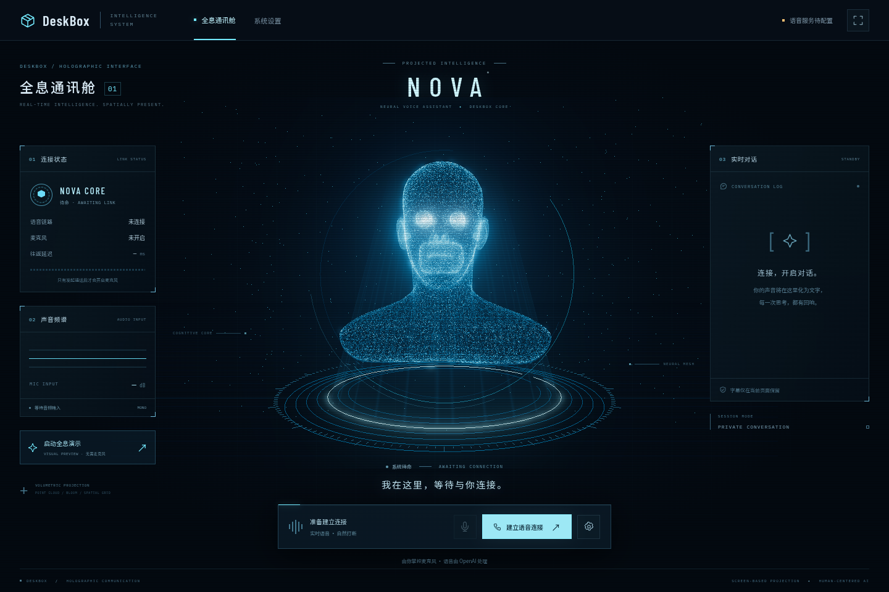

# DeskBox · NOVA 全息通讯舱

DeskBox 软件内的沉浸式全息 AI 语音空间。Three.js / WebGL 三维粒子人像、面部轮廓、扫描线、泛光、多层空间投影环及透视网格，随倾听、思考和 AI 发声状态响应。桌面窗口内支持实时语音、直接打断、静音、挂断、字幕和设置；全息为屏幕内的空间视觉效果。



## 桌面软件

需要 Node.js 22.9+（推荐 24）。

```bash
npm ci
npm run desktop
```

在软件的「系统设置」中填写 OpenAI API 密钥，保存后点击「建立语音连接」。桌面模式会自动启动本机服务，无需另开浏览器或终端服务器。密钥不会返回页面，系统安全存储可用时通过 Electron safeStorage 加密存入当前用户目录；系统密钥链不可用时仅在本次运行的内存中使用。打包产物不包含开发者密钥。

窗口默认启用 GPU 渲染。右上角可进入全屏，鼠标在投影上移动可改变观察角度。设置中可以选择声音、语言、回复音量和减少动态效果。没有密钥也可使用「启动全息演示」，该模式不启用麦克风，不生成虚假对话或连接指标。

### 打包

```bash
# Windows x64，输出 release/DeskBox-0.1.0-win.zip
npm run pack -- --win zip --x64
# macOS：在对应架构的 Mac 上运行
npm run pack -- --mac zip
```

Windows 压缩包解压后运行 DeskBox.exe。当前打包配置未做应用签名；Windows 实机音频、系统密钥库与 macOS 打包需要在对应系统验收。Electron 渲染进程启用隔离与沙箱，禁止 Node.js 访问、外部导航与弹窗，麦克风仅向本机应用页面开放。

## 浏览器开发

```bash
cp .env.example .env
# 在 .env 中填写自己的 OPENAI_API_KEY
npm start
```

打开 http://127.0.0.1:3000 。`npm start` 会先构建本地三维渲染资源；除可选的外部字体外，运行时不依赖 CDN。浏览器模式的 API 密钥在服务器环境变量配置，桌面模式也支持开发用 `.env`。

## 真实语音

需要有效的 OpenAI API 密钥、可用额度及 `gpt-realtime-2.1` 模型权限。语音通过 WebRTC 与 OpenAI 连接，字幕转写使用 `gpt-4o-mini-transcribe`，会产生 API 费用。

语音活动检测自动回复，可直接说话打断。实际麦克风与 AI 输出音量驱动投影及波形，延迟来自 WebRTC 选中连接的往返时间，未连接时不显示虚构数据。字幕只保留在当前页面内存，刷新即清除。挂断、连接失败或关闭窗口会释放麦克风并关闭连接。

浏览器远程访问需要 HTTPS（localhost 除外）并允许 WebRTC 网络通信。默认仅监听 `127.0.0.1`。如将服务公开，须先加上身份验证与使用配额；本版本定位为本地单用户软件。

## 验证

```bash
npm run build
npm test
node --check public/app.js
node --check desktop/main.mjs
```

自动检查覆盖接口校验、跨站拦截、密钥隔离与切换、SDP 转发、上游错误、字幕、语音状态、取消连接时的麦克风清理。浏览器视觉检查覆盖全息渲染、演示、设置及窄屏布局。真实 OpenAI 通话仍需使用有效密钥做端到端验证。

## 模型来源

全息人像使用 Lee Perry-Smith 的 Infinite 3D Head Scan（[来源](https://github.com/mrdoob/three.js/tree/dev/examples/models/gltf/LeePerrySmith)，CC BY 3.0，基于 www.triplegangers.com），转化为粒子和线框后渲染。授权说明位于 `public/assets/LeePerrySmith_License.txt`。模型加载失败时使用内置程序化人像。
